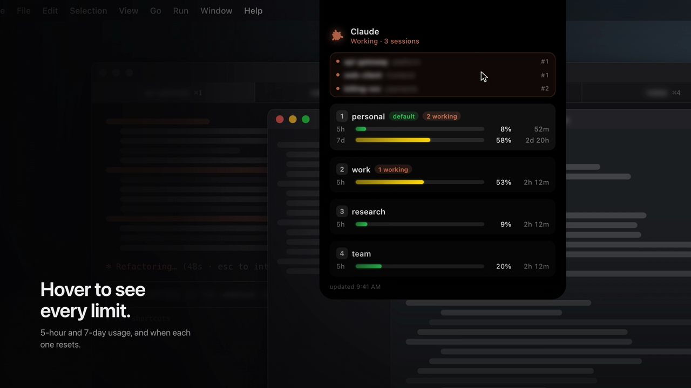

# ClaudeNotch

ClaudeNotch is a small macOS app that shows Claude Code status around the MacBook notch. It shows the usage of each claude-swap account. It also shows which Claude Code sessions are working. It also has a page for short notes.

claude-swap is a command-line tool that runs Claude Code with more than one account. ClaudeNotch reads the data of claude-swap. It does not change that data.

## Demo video

The video shows the collapsed state, the expanded state, and a click that opens the terminal of a session. The video is 31 seconds long and has no sound. The session names in the video are blurred.

[](docs/demo.mp4)

To play the video, click the image. The file is [docs/demo.mp4](docs/demo.mp4).

## What the app shows

The app has two states. The collapsed state is a black strip around the notch. When you move the pointer over the notch, the expanded state opens. When you move the pointer away, it closes.

The collapsed state shows these items:

- The Claude mark, on the left of the notch. If no session is working, the mark does not move.
- A number next to the mark. If one or more sessions are working, the mark turns and the number shows the count of working sessions.
- A blue dot that pulses, with a count. If one or more sessions wait for your answer, the dot shows. Examples are a question from Claude and a permission prompt.
- One small bar for each account, on the right of the notch. Each bar shows the 5-hour usage of that account.
- The 5-hour usage of the default account, as a percentage next to the bars.

The default account is the account that a plain `claude` command uses. claude-swap keeps the credentials of this account in `~/.claude`. A terminal tab that you start with `claude-swap run N` uses account `N` instead.

The expanded state shows a blue list of the sessions that wait for your answer. Each row says `question` or `permission`. Below it, the expanded state shows a list of the working sessions. For each session, the list shows the session name, the folder, and the account number. Below the list, a card for each account shows one row of ring gauges: the 5-hour limit, the 7-day limit, and the time until each limit resets. The percentage is inside the ring. If claude-swap reports a weekly limit for one model, the card shows a ring with the name of that model, for example `Fable`. When the 7-day limit of an account reaches 90%, the card hides the 5-hour ring, and the notch shows the 7-day percentage for that account. When the 7-day limit reaches 100%, the card also hides the rings of the model limits, so only the 7-day ring stays. The header has a pencil button for the [notes](#notes) and the `Lembur` button for [mode lembur](#mode-lembur).

If you turn on Reduce Motion in System Settings, the mark does not turn. A glow around the mark then shows that a session is working.

## Open the terminal of a session

You can click a row in the expanded state to go to the terminal of that session:

- If you click a session in the list of working sessions, the terminal of that session comes to the front.
- If you click an account card, the terminal of a session of that account comes to the front. The app selects a working session first. If the account has more than one session, each click goes to the next session.

When you move the pointer over an account card, a label shows the name of the terminal app. If the account has more than one open session, the label also shows the count. If the account has no open session, the card shows "no open session" and a click does nothing.

The result is different for each terminal app:

| Terminal app | Result of a click |
| --- | --- |
| iTerm2 | The app selects the window, the tab, and the split pane of the session. |
| Terminal | The app selects the window and the tab of the session. |
| Other apps, for example Warp or Ghostty | The terminal app comes to the front. These apps do not let other apps select a tab, so you must select the tab yourself. |

For iTerm2 and Terminal, the app uses AppleScript to select the tab. If you click a session in one of these apps for the first time, macOS asks if ClaudeNotch can control that app. Click OK. The app has an ad hoc signature, so macOS can ask again after each `./build.sh`.

## Mode lembur

Mode lembur keeps the Mac awake until every Claude Code agent on this Mac stops. Then it puts the Mac to sleep. If you leave long work running and do not want the Mac to stay on all night, use this mode.

To turn on mode lembur, open the expanded state and click `Lembur` in the header. The button turns purple, and a moon shows next to the Claude mark in the collapsed state. To cancel, click the button again.

While the mode is on, the app holds a macOS power assertion (a request to the system that blocks idle sleep). The display can still turn off and lock. A locked screen does not stop the work. Only system sleep stops it.

If all of these conditions are true, the app puts the Mac to sleep. Otherwise, the Mac stays awake.

- No session reads `busy`. A session that waits for your answer does not count as running, because it cannot continue without you.
- No busy Bash tool shell runs under a live session. This includes a background task that the session started. A resting service does not count (see [Resting services](#resting-services)).
- No transcript in `~/.claude/projects` or `~/.claude-swap-backup/sessions/*/projects` changed in the last 3 minutes. This catches a background subagent, which writes its own transcript while its session reads `idle`.

These conditions must stay true for 2 minutes. The header button then shows a countdown. If any activity starts during the countdown, the countdown stops and starts again later. When the countdown ends, the app makes a new scan. If the new scan agrees, the app releases the assertion and runs `pmset sleepnow`.

The mode is one-shot. After the sleep, the mode is off. If the app restarts, the mode is also off.

The checks cover the whole Mac, not one tab, because a sleep stops the work in every tab. A session can still get a new prompt one second after the sleep starts. The app cannot prevent this case.

## Notes

The notes are one page of plain text in the expanded state.

To write a note, do these steps:

1. Move the pointer over the notch to open the expanded state.
2. Click the pencil button in the header, next to `Lembur`. The session list and the account cards change to a text field, and the text cursor goes into it.
3. Write your note. The app saves the text each time that it changes, so you do not save it yourself.

To close the notes, press Esc, click the pencil button again, or click outside the notch. The next time that the expanded state opens, it shows the sessions again.

If the text cursor is in the notes and the pointer moves away, the expanded state stays open. The app that you used before stays the frontmost app, and its menu bar stays. When the notes close, the keyboard goes back to that app.

The usual shortcuts work in the notes: Cut, Copy, Paste, Select All, Undo, and Redo.

The app keeps the notes in `~/Library/Application Support/ClaudeNotch/notes.md`. You can also open this file in another editor. The app reads the file again each time that the notes open. If you edit the file in another editor while the notes are open, the next change in the notes replaces that edit.

## Requirements

You must have these items before you install the app:

- A Mac with macOS 15 or later. A MacBook with a notch gives the best result. On other screens, the app uses a strip with the height of the menu bar.
- The Command Line Tools for Xcode 16 or later. The build script uses the `swiftc` compiler from these tools.
- claude-swap at the path `~/.local/bin/claude-swap`. The app reads claude-swap only from this path.

## Install

1. Install the Command Line Tools for Xcode. If the tools are already on your Mac, skip this step.

   ```bash
   xcode-select --install
   ```

2. Install claude-swap. Follow the steps in the [claude-swap repository](https://github.com/realiti4/claude-swap).

3. Make sure that claude-swap is at the expected path. If the file exists, the command prints the path.

   ```bash
   ls ~/.local/bin/claude-swap
   ```

4. Clone this repository into a folder of your choice, and go into that folder.

   ```bash
   git clone git@github.com:irsalsss/claude-notch-app.git
   cd claude-notch-app
   ```

5. Build the app and start it.

   ```bash
   ./build.sh
   ```

The script compiles `ClaudeNotch.swift` into `~/Applications/ClaudeNotch.app`. Then it signs the app with an ad hoc signature, which is a local signature with no developer account. Then it writes a launch agent to `~/Library/LaunchAgents/com.irsalsss.claude-notch.plist` and loads it.

A launch agent is a job that macOS starts for your user account. When you log in, macOS starts the app. If the app stops, macOS starts it again.

## Update

To update the app, get the new code and run the build script again from the folder of the repository:

```bash
git pull
./build.sh
```

The script stops the running copy of the app and starts the new build. You do not have to log out.

## Uninstall

1. Stop the app and remove the launch agent.

   ```bash
   launchctl bootout "gui/$(id -u)/com.irsalsss.claude-notch"
   rm ~/Library/LaunchAgents/com.irsalsss.claude-notch.plist
   ```

2. Delete the app.

   ```bash
   rm -rf ~/Applications/ClaudeNotch.app
   ```

3. If you do not want the source code, delete the folder of the repository.

4. If you do not want your notes, delete the folder of the notes.

   ```bash
   rm -rf "$HOME/Library/Application Support/ClaudeNotch"
   ```

## How the app gets its data

The app reads the usage data from claude-swap. It runs `claude-swap list --json` every 60 seconds. It also runs the command each time that the expanded state opens.

The app reads the session activity from files that Claude Code writes. Claude Code writes one file, `sessions/<pid>.json`, for each running session. Each file has a `status` field with the value `busy`, `idle`, `shell`, or `waiting`. A `waiting` file also has a `waitingFor` field. The value `input needed` is a question, and the values `permission prompt`, `sandbox request`, `worker request`, and `goal proposal` are permission requests. The value `dialog open` is a dialog that you opened yourself, so the app does not count it. The app reads these files every second.

The session files are in two places. Sessions that use the default account are in `~/.claude/sessions`. Sessions that you start with `claude-swap run N` are in `~/.claude-swap-backup/sessions/<N-email>/sessions`.

A session file can stay on the disk after its process stops, for example after a crash. If no process with that process ID exists, the app ignores the file. This rule stops the mark from turning for a session that is gone.

### Resting services

If the turn of a session is over and a background Bash task of the session still runs, Claude Code writes `shell`. For example, `pnpm dev` can keep a session in `shell` for days. If a background shell of the session does work, the app counts the session as working.

Every 5 seconds, the app reads the process tree of each background shell. If both of these conditions are true, the shell rests and does not count:

- The shell runs a service. A service listens on a TCP port. A service can also be a child process with one of these words in its command: `dev`, `serve`, `preview`, `--watch`. The other words are `-w`, `tail -f`, and `nodemon`.
- The whole process tree of the shell uses less than 5% CPU.

All other shells count as busy, for example a build, a test run, or `gh run watch`. A service that rebuilds after you save a file uses more CPU, so it counts as busy during the rebuild. A background task that waits on the network uses no CPU, but it does not match a service, so it stays busy. Mode lembur uses the same rule.

## Privacy

The app does not send data over the network. Only claude-swap makes network requests, to get the usage data. The app writes only one file, the notes file in `~/Library/Application Support/ClaudeNotch/notes.md`. It does not keep a history of the usage or the sessions. In mode lembur, the app reads only the modification time of each transcript, not its content.

If your account names are private, do not share screenshots of the expanded state. Each account card shows the first part of the account email, or the alias that you set in claude-swap.

## Troubleshooting

Use this table to find the cause of a problem:

| Problem | Cause and fix |
| --- | --- |
| The expanded state shows an error line. | Run `~/.local/bin/claude-swap list --json` in Terminal. The app reads the same output, so Terminal shows the same error. |
| A meter shows `–` in place of a percentage. | claude-swap has no usage data for that limit. Team plans do not report a 7-day limit, so the app does not show that ring for them. |
| The mark does not turn while a session works. | Make sure that the session file of that session is in one of the folders in "How the app gets its data". |
| A click brings the terminal to the front, but not the correct tab. | Open System Settings > Privacy & Security > Automation. Turn on iTerm2 or Terminal under ClaudeNotch. The footer of the expanded state also shows this message. |
| The notes show `Could not save the notes`. | The app cannot write the notes file. The line shows the reason from macOS. Make sure that your user account can write to `~/Library/Application Support/ClaudeNotch`. |
| The app does not start after `./build.sh`. | Read the status of the launch agent with `launchctl print "gui/$(id -u)/com.irsalsss.claude-notch"`. |

## License

This project uses the MIT License. The full text is in [LICENSE](LICENSE).
